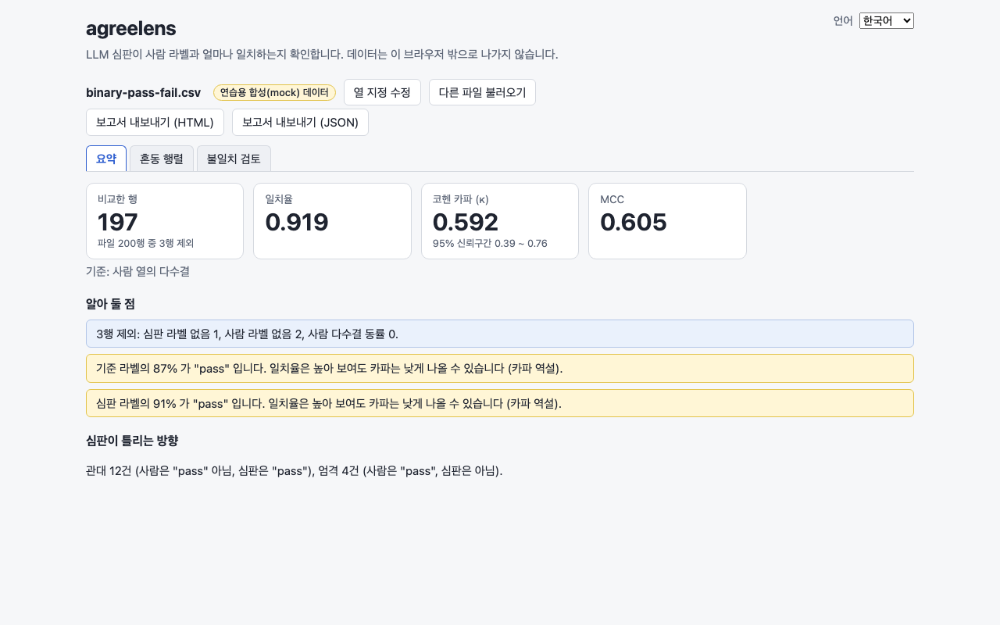
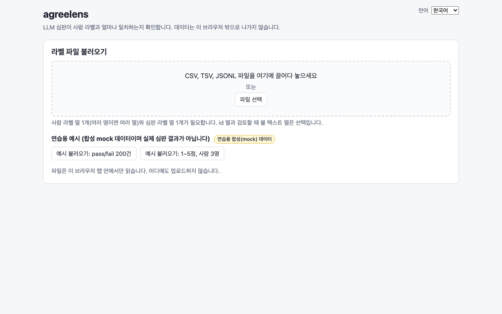
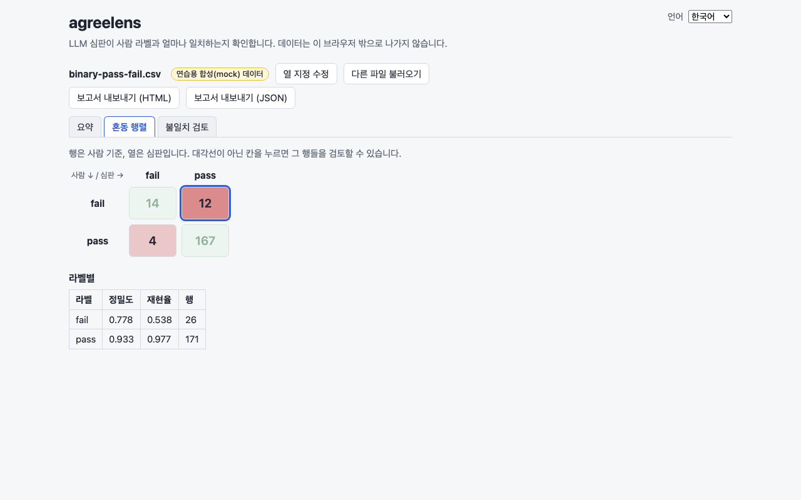
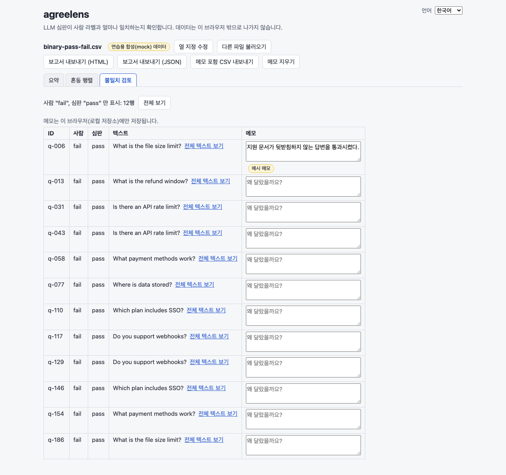
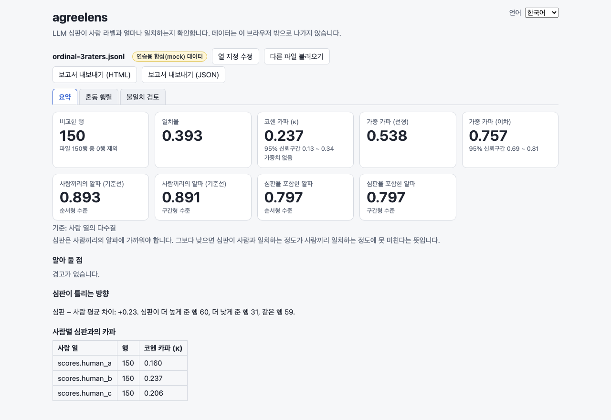
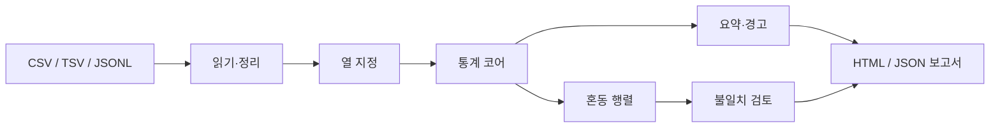

# agreelens

[English](README.md) | **한국어**

LLM 심판(LLM judge)이 사람 라벨과 얼마나 일치하는지 확인하는 도구입니다. CSV, TSV, JSONL 파일을 브라우저에서 불러오면 일치율, Cohen's kappa(카파), Krippendorff's alpha(알파), 혼동 행렬, 불일치 사례 검토를 보여 줍니다. 아무것도 업로드하지 않습니다. 앱 전체가 로컬 HTML 파일 하나입니다.


*pass/fail 연습용 예시: 심판이 사람과 92% 일치하지만 카파는 0.59뿐이고, 경고가 그 이유를 알려 줍니다.*

## 이런 분께

- LLM을 심판(답변을 채점하는 모델)으로 쓰고, 믿고 쓰기 전에 "신뢰할 수 있나?"에 대한 숫자가 필요한 분
- 수백 행에 대한 사람 라벨과 같은 행의 심판 라벨이 있는 분(어느 평가 도구에서 내보낸 것이든 됩니다)
- 평가 데이터를 외부 서비스에 보낼 수 없거나 보내고 싶지 않은 분

## 설치

Node.js 22.22.2 이상 22 계열, 24.15 이상 또는 26 이상(`package.json`의 `engines` 범위)과 git이 필요합니다. `agreelens`는 아직 패키지 저장소에 게시하지 않았으므로 소스에서 빌드합니다.

```bash
# Node.js: https://nodejs.org/ (nvm 사용 시: nvm install 22)
git clone https://github.com/LeeGyeongPil/agreelens.git
cd agreelens
npm ci
```

최소 리눅스 이미지에서는 `git`과 Node.js(npm 포함)만 있으면 됩니다. 다른 시스템 패키지는 필요 없습니다.

## 빠르게 시작하기

```bash
npm start
```

```text
agreelens is ready: <repo>/dist/index.html
Open file://<repo>/dist/index.html in your browser. The file works on its own; you can copy it anywhere.
```

`npm start`는 `dist/index.html`을 빌드하고 기본 브라우저로 엽니다. 서버나 CI에서는 브라우저를 열지 않으니(`CI=1` 또는 `npm start -- --no-open`) 출력된 경로를 직접 여세요.


*시작 화면. 파일을 끌어다 놓거나 연습용 예시 버튼을 누르세요.*

**예시 불러오기: pass/fail 200건**을 누르세요. 예시는 연습용으로 만든 합성(mock) 데이터이며 실제 심판 출력이 아닙니다. 화면에도 "연습용 합성(mock) 데이터" 배지가 붙습니다.

## 결과 읽기

pass/fail 예시(200행 중 쓸 수 있는 라벨이 없는 3행을 제외해 197행 비교)의 값입니다.

| 숫자 | 값 | 뜻 |
|---|---|---|
| 일치율 | 0.919 | 심판과 사람이 같은 라벨을 낸 행의 비율 |
| Cohen's kappa | 0.592 (부트스트랩 95% 신뢰구간 약 0.39~0.76) | 두 평가자가 우연히 맞을 몫을 뺀 일치도 |
| MCC | 0.605 | 두 라벨용 또 다른 우연 보정 점수 |
| 관대 / 엄격 | 12 / 4 | 사람은 fail인데 심판이 pass한 행 12개(관대), 사람은 pass인데 심판이 fail한 행 4개(엄격) |

0.92와 0.59가 다른 이유: 사람 라벨의 87%, 심판 라벨의 91%가 "pass"입니다. 둘 다 대부분 "pass"라고 하면 우연히도 많이 겹치므로 카파가 훨씬 낮아집니다. 이것이 카파 역설이며, 한 라벨이 85% 이상이면 agreelens가 경고를 띄웁니다. 관대한 12행부터 살펴보세요.


*혼동 행렬. 행은 사람 기준, 열은 심판입니다. 선택한 셀은 사람 "fail", 심판 "pass"로 12행입니다.*

대각선이 아닌 셀을 누르면 해당 행이 열립니다.


*선택한 셀의 불일치 사례와 전체 텍스트, 메모 칸. 메모는 브라우저 로컬 저장소에만 남으며 예시 메모에는 "예시 메모" 배지가 붙습니다.*

순서형 예시(1~5점, 150행, 사람 3명)는 두 가지를 더 보여 줍니다.


*순서형 예시. 가중하지 않은 카파는 낮지만 가중 카파는 근접한 점수를 부분 일치로 칩니다.*

| 숫자 | 값 | 뜻 |
|---|---|---|
| 일치율 | 0.393 | 점수가 정확히 같은 경우만 |
| 카파(가중 없음 / 선형 / 이차) | 0.237 / 0.538 / 0.757 (이차 신뢰구간 0.69~0.81) | 가중 카파는 4와 5처럼 가까운 점수에 점수를 줍니다. |
| Krippendorff's alpha(순서형) | 사람끼리 0.893, 심판 포함 0.797 | 사람끼리가 심판과보다 더 잘 일치합니다. 심판은 이 기준선과 비교해 봅니다. |

카파의 경험적 기준("0.6 초과는 상당한 일치" 등)은 대략적이고 과제마다 다릅니다. 신뢰구간과 함께 보세요. 통계가 정의되지 않으면 이유와 함께 NA를 보여 줍니다. 심판만 라벨 하나를 쓰면 카파는 (scikit-learn과 같이) 경고와 함께 0이고 MCC는 NA입니다. 카파가 NA인 경우는 양쪽이 같은 라벨 하나만 쓰거나 비교할 수 있는 행이 없을 때입니다.

## 내 데이터 쓰기

사람 라벨 열 하나(여러 명이면 여러 열)와 심판 라벨 열 하나가 필요합니다. id 열과 읽을 텍스트 열은 선택입니다. 예시 파일은 [`examples/`](examples/)에 있습니다.

```text
id,question,answer,human,judge,judge_reason
1,What is the refund window?,Refunds are accepted within 30 days.,pass,pass,Matches the policy page.
2,Which plan includes SSO?,SSO is included in every plan.,fail,pass,Plausible answer.
```

```json
{"id": "a1", "input": {"question": "Summarize the notes.", "answer": "The team ships on Friday."}, "scores": {"human": 4, "judge": 5}, "judge_reason": "Complete."}
```

- 형식: `.csv`, `.tsv`, `.jsonl`. 중첩된 JSONL 키는 `scores.human` 같은 점 경로가 됩니다.
- 불러온 뒤 열을 지정합니다. 열 이름으로 기본값을 추측해 줍니다.
- 정리: 공백 제거, 대소문자 무시, 결측으로 볼 값 지정. 라벨 표에서 표기를 합치거나 라벨을 제외할 수 있습니다.
- 순서가 있는 문자열 라벨(예: `bad`, `ok`, `good`)은 순서를 직접 지정하세요. 지정하지 않으면 알파벳순입니다.
- 사람 열이 여러 개면 다수결로 합칩니다. 동률과 빈 칸은 추측하지 않고 제외하며 알림에 개수를 적습니다.
- 내보내기: HTML 보고서, JSON 보고서, 메모를 포함한 불일치 CSV.

## 설정

| 항목 | 위치 | 기본값 |
|---|---|---|
| 언어 | 페이지 위쪽 언어 메뉴(로컬 저장소에 저장). 주소의 `?lang=en` 또는 `?lang=ko` 도 선택하고 저장합니다. | 영어. 아주 첫 방문에만 브라우저가 한국어면 한국어로 시작 |
| 공유용 화면 | 주소 옵션 `?sample=binary\|ordinal`, `?view=summary\|matrix\|review`, `?cell=<사람>,<심판>` | 시작 화면 |
| 척도 | 명목 또는 순서형 | 명목 |
| 기준 | 사람 열의 다수결 또는 한 열 | 다수결 |

부트스트랩 재표본은 시드를 고정하므로 같은 파일이면 항상 같은 구간이 나옵니다.

## 동작 원리



1. 파일을 브라우저 탭 안에서 읽고 정리합니다(공백, 대소문자, 결측).
2. 열을 지정하면 사람 기준 라벨을 다수결로 만듭니다.
3. UI 코드가 없는 통계 코어가 일치율, 카파, 알파, MCC, 부트스트랩 구간, McNemar 검정을 계산합니다.
4. 화면은 그 결과를 그리기만 하며, 정의되지 않은 값은 이유와 함께 NA로 둡니다.
5. 불일치 행을 검토하고 메모를 쓰고 내보냅니다.

개인정보: 빌드 결과는 모든 네트워크 요청을 막는 Content-Security-Policy(`connect-src 'none'`)가 든 단일 파일입니다. `scripts/check-dist.mjs`가 이를 확인하고, 소스에 fetch·XHR·WebSocket 호출이 없는지도 검사합니다.

정확도: 테스트는 scikit-learn 1.9.1, krippendorff 0.9.0, statsmodels 0.15.0의 참값(`tests/fixtures/ref.json`)과 결과를 비교합니다. 참값은 다음으로 다시 만듭니다.

```bash
uv run --with scikit-learn==1.9.1 --with krippendorff==0.9.0 --with statsmodels==0.15.0 python scripts/make_ref.py tests/fixtures/ref.json
```

## 언제 쓰나

- 잘 맞는 경우: 수백 개 사람 라벨로 심판을 처음, 비공개로 점검할 때, 그리고 심판 프롬프트에서 어떤 종류의 불일치를 고칠지 찾을 때
- 다루지 않는 것: 심판 실행, 실험 추적, 실시간 모니터링. 그런 용도는 [Langfuse](https://langfuse.com/), [LangSmith](https://www.langchain.com/langsmith)를 보세요. 사람용 라벨링 과제를 만들려면 [Potato](https://github.com/davidjurgens/potato), 단순 카파 계산기는 [yishaik/kappa](https://github.com/yishaik/kappa)가 있습니다. 현재 기능은 각 도구의 문서에서 확인하세요(2026-11-11 확인).

## 자주 겪는 문제

| 증상 | 원인 | 해결 |
|---|---|---|
| `npm start`가 경로만 출력하고 브라우저가 열리지 않음 | `CI`가 설정됐거나 데스크톱 브라우저가 없음 | 출력된 `file://` 주소를 직접 여세요. |
| 파일을 쓸 수 없다는 화면 | 빈 파일, 헤더 행 없음, JSON 객체가 아닌 JSONL 줄 | 메시지를 읽고 헤더 행이 있는 CSV, TSV, JSONL로 다시 내보내세요. |
| 카파가 NA | 양쪽이 같은 라벨 하나만 썼거나 두 라벨이 모두 있는 행이 없음 | NA 옆 이유를 보세요. 심판만 라벨 하나를 썼다면 카파는 경고와 함께 0, MCC는 NA입니다. |
| 문자열 라벨의 가중 카파가 이상함 | 순서를 지정하지 않아 알파벳순으로 처리됨 | 라벨 표에서 순서를 지정하세요. |
| 카파는 NA인데 "카파는 0" 경고가 함께 뜸 | 알려진 문제: 양쪽이 같은 라벨 하나만 쓰면 NA 옆에 심판 단일 라벨 경고가 같이 나타남 | NA와 그 이유를 믿으세요. 이 경우 경고는 해당하지 않습니다. |
| CSV 오류의 행 번호가 하나 큼 | 알려진 문제: 닫히지 않은 따옴표 오류는 메시지의 데이터 행 번호가 1 큼(다른 CSV 오류는 정확함) | 표시된 번호의 바로 앞 행을 확인하세요. |
| 파일보다 행이 적게 비교됨 | 결측과 동률 다수결은 제외됨 | "N행 제외" 알림에서 개수를 확인하세요. |

## 로드맵

계획만 있고 아직 만들지 않은 것: 메타데이터 열 구간별 카파, 수치 점수 심판의 임계값 스윕, 심판 v1/v2 비교 화면, GitHub Pages 배포. McNemar 검정은 그 비교를 위해 통계 코어에 이미 있지만 아직 어느 화면·보고서에도 나오지 않습니다. 평가 도구별 내보내기 안내는 없으며, 헤더 행이 있는 CSV, TSV, JSONL이면 됩니다.

## 개발·기여

```bash
npm test          # Vitest
npm run build && node scripts/check-dist.mjs
node scripts/smoke-dist.mjs
```

작성 시점 기준 테스트 파일 12개, 테스트 117개가 모두 통과하며, 빌드된 페이지는 768 kB 파일 하나입니다(gzip 149 kB). 버그와 제안은 이슈로 남겨 주세요. 변경 기록은 [CHANGELOG.md](CHANGELOG.md).

## 라이선스

MIT. 함께 들어 있는 연습용 예시는 이 프로젝트를 위해 만든 합성 데이터입니다.
