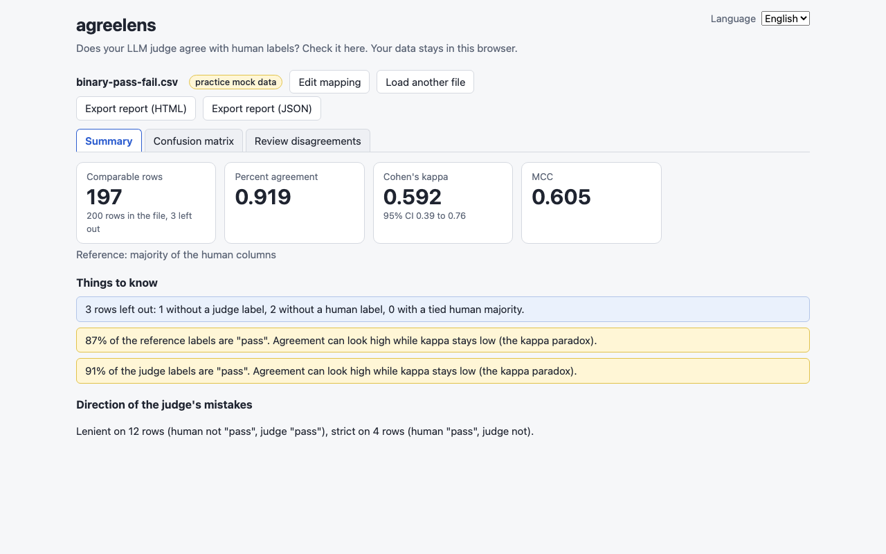
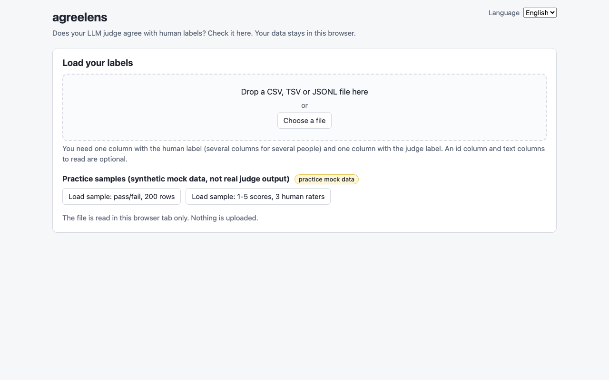
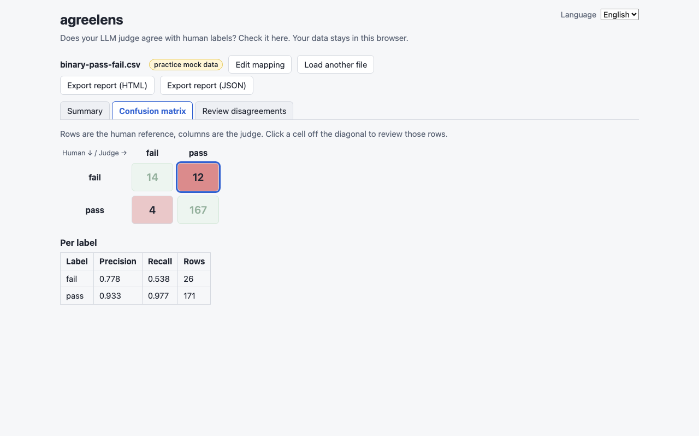
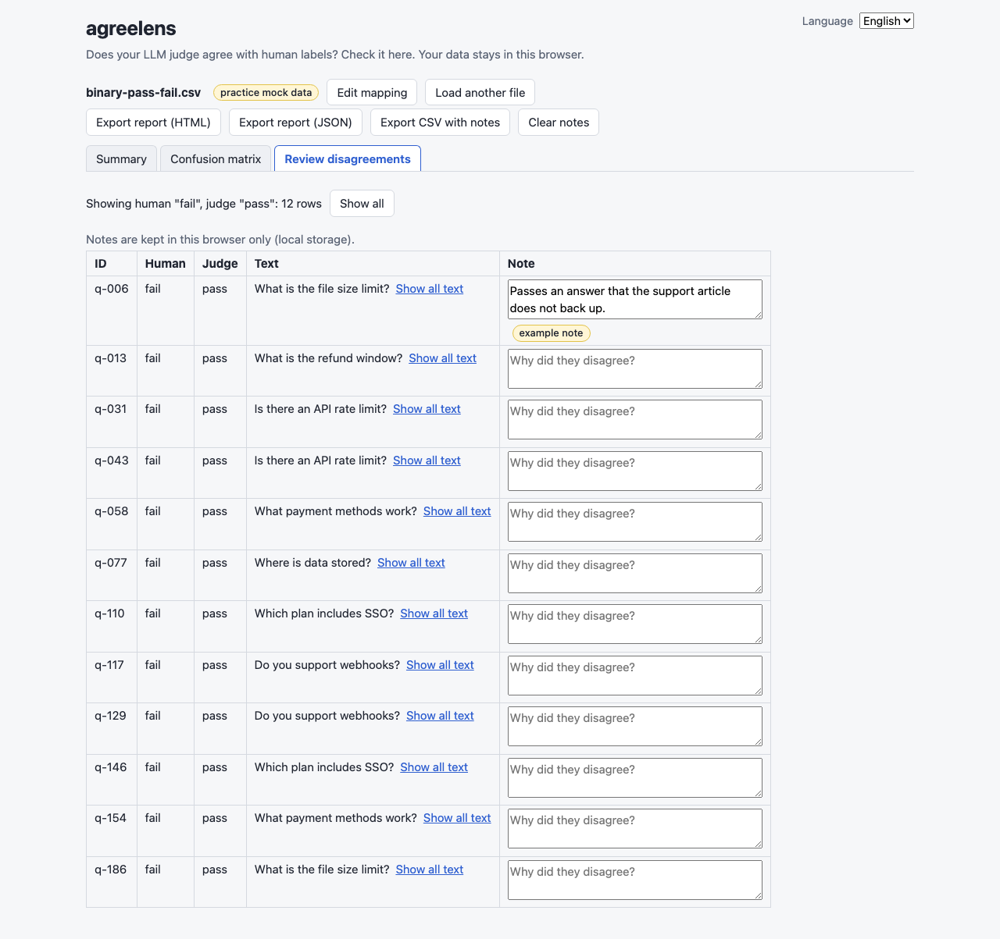
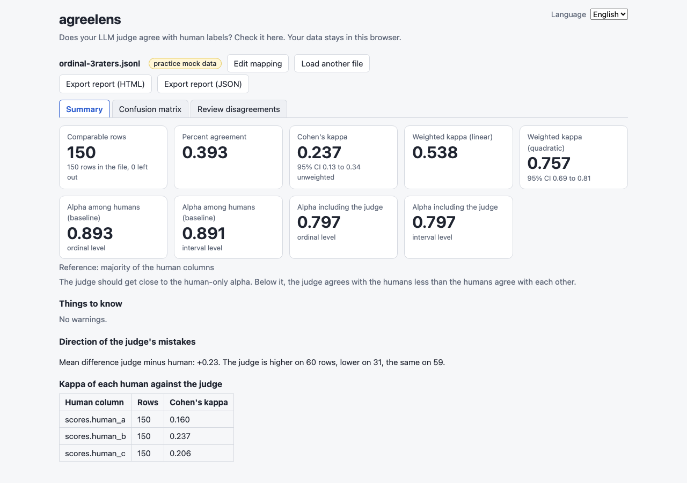
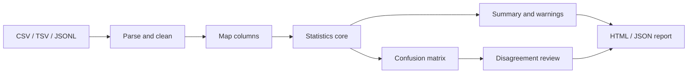

# agreelens

**English** | [한국어](README.ko.md)

Check whether your LLM judge agrees with human labels. Load a CSV, TSV or JSONL file in your browser and get agreement, Cohen's kappa, Krippendorff's alpha, a confusion matrix and a disagreement review. Nothing is uploaded: the app is one local HTML file.


*The pass/fail practice sample: the judge agrees with humans on 92% of rows, yet kappa is only 0.59, and the warning says why.*

## Who this is for

- You use an LLM as a judge (a model that grades answers) and want a number for "can I trust it?" before you rely on it.
- You have human labels for a few hundred rows and the judge's labels for the same rows, exported from any evaluation tool.
- You cannot or do not want to send evaluation data to a hosted service.

## Install

You need Node.js 22.22.2+, 24.15+ or 26+ (the `engines` range in `package.json`) and git. `agreelens` is not published to a package registry yet, so you build it from source.

```bash
# Node.js: https://nodejs.org/ (or, with nvm: nvm install 22)
git clone https://github.com/LeeGyeongPil/agreelens.git
cd agreelens
npm ci
```

On a minimal Linux image you only need `git` and Node.js (with npm); no other system packages are required.

## Quick start

```bash
npm start
```

```text
agreelens is ready: <repo>/dist/index.html
Open file://<repo>/dist/index.html in your browser. The file works on its own; you can copy it anywhere.
```

`npm start` builds `dist/index.html` and opens it in your default browser. On a server or in CI no browser is opened (`CI=1`, or `npm start -- --no-open`); open the printed path yourself.


*Start screen. Drop your file, or press a practice sample button.*

Press **Load sample: pass/fail, 200 rows**. The samples are synthetic mock data made for practice, not real judge output; the screen says so with a "practice mock data" badge.

## Reading the results

For the pass/fail sample (200 rows, 3 left out because they have no usable label, so 197 compared):

| Number | Value | What it means |
|---|---|---|
| Percent agreement | 0.919 | Share of rows where judge and human gave the same label. |
| Cohen's kappa | 0.592 (bootstrap 95% CI about 0.39 to 0.76) | Agreement after removing what two raters would match by chance. |
| MCC | 0.605 | Another chance-corrected score for two labels. |
| Lenient / strict | 12 / 4 | Judge passed 12 rows humans failed (lenient); judge failed 4 rows humans passed (strict). |

Why 0.92 and 0.59 differ: 87% of human labels and 91% of judge labels are "pass". Two raters who both say "pass" most of the time agree a lot by luck, so kappa is much lower. This is the kappa paradox, and agreelens shows a warning when one label makes up 85% or more of the data. The 12 lenient rows are where to look first.


*Confusion matrix. Rows are the human reference, columns are the judge. The selected cell is human "fail", judge "pass": 12 rows.*

Click a cell off the diagonal to open those rows.


*Disagreements for the selected cell, with the full text and a note field. Notes stay in your browser's local storage; the example note carries an "example note" badge.*

The ordinal sample (1-5 scores, 150 rows, 3 human raters) shows two more ideas:


*Ordinal sample. Unweighted kappa is low, but weighted kappa counts near-misses as partial agreement.*

| Number | Value | What it means |
|---|---|---|
| Percent agreement | 0.393 | Exact score matches only. |
| Kappa (unweighted / linear / quadratic) | 0.237 / 0.538 / 0.757 (quadratic CI 0.69 to 0.81) | Weighted kappa gives credit for scores that are close, such as 4 vs 5. |
| Krippendorff's alpha (ordinal) | 0.893 humans only; 0.797 with the judge | The humans agree among themselves more than they agree with the judge: that is the baseline the judge is measured against. |

Rules of thumb for kappa (for example "above 0.6 is substantial") are rough and depend on the task; use them with the confidence interval, not alone. When a statistic is undefined agreelens shows NA with a reason. If only the judge uses a single label, kappa is 0 (as in scikit-learn) with a warning, and MCC is NA. Kappa is NA when both sides use the same single label or no row can be compared.

## Use your own data

You need one column with the human label (several columns for several people) and one column with the judge label. An id column and text columns for reading are optional. Example files are in [`examples/`](examples/):

```text
id,question,answer,human,judge,judge_reason
1,What is the refund window?,Refunds are accepted within 30 days.,pass,pass,Matches the policy page.
2,Which plan includes SSO?,SSO is included in every plan.,fail,pass,Plausible answer.
```

```json
{"id": "a1", "input": {"question": "Summarize the notes.", "answer": "The team ships on Friday."}, "scores": {"human": 4, "judge": 5}, "judge_reason": "Complete."}
```

- Formats: `.csv`, `.tsv`, `.jsonl`. Nested JSONL keys become dot paths such as `scores.human`.
- After loading, map the columns. agreelens guesses defaults from the column names.
- Cleaning: trim spaces, ignore case, and choose which values count as missing. A label table lets you merge spellings or leave a label out.
- For ordered text labels (for example `bad`, `ok`, `good`), set the order yourself; without it, the order is alphabetical.
- Several human columns are combined by majority. Ties and empty cells are left out and counted in a notice, never guessed.
- Export: HTML report, JSON report, and a CSV of disagreements that includes your notes.

## Settings

| Option | Where | Default |
|---|---|---|
| Language | Language menu (top of the page); saved in local storage. `?lang=en` or `?lang=ko` in the address also sets and saves it. | English; only on the very first visit a browser set to Korean starts in Korean |
| Shareable view | Address options `?sample=binary\|ordinal`, `?view=summary\|matrix\|review`, `?cell=<human>,<judge>` | start screen |
| Scale | Nominal or ordinal | nominal |
| Reference | Majority of human columns, or one column | majority |

Bootstrap resampling uses a fixed seed, so the same file always gives the same interval.

## How it works



1. The file is read in the browser tab and cleaned (trim, case, missing values).
2. You map columns; the human reference is built by majority.
3. A statistics core with no UI code computes agreement, kappa, alpha, MCC, bootstrap intervals and McNemar's test.
4. The screens only draw that result; undefined values are NA with a reason.
5. You review disagreement rows, write notes and export.

Privacy: the build is a single file with a Content-Security-Policy that blocks all network requests (`connect-src 'none'`). `scripts/check-dist.mjs` verifies this and that the source never calls fetch, XHR or WebSocket.

Accuracy: the tests compare results with reference values from scikit-learn 1.9.1, krippendorff 0.9.0 and statsmodels 0.15.0 (`tests/fixtures/ref.json`). Regenerate them with:

```bash
uv run --with scikit-learn==1.9.1 --with krippendorff==0.9.0 --with statsmodels==0.15.0 python scripts/make_ref.py tests/fixtures/ref.json
```

## When to use it

- Good fit: a first, private check of a judge against a few hundred human labels, and finding which kind of disagreement to fix in the judge prompt.
- Not covered: running the judge, tracking experiments, or live monitoring. For those, see [Langfuse](https://langfuse.com/) or [LangSmith](https://www.langchain.com/langsmith). For building annotation tasks for humans, see [Potato](https://github.com/davidjurgens/potato). For a plain kappa calculator, see [yishaik/kappa](https://github.com/yishaik/kappa). Check their own documentation for what they currently do (checked 2026-11-11).

## Troubleshooting

| Symptom | Cause | Fix |
|---|---|---|
| `npm start` prints a path but no browser opens | `CI` is set, or no desktop browser is available | Open the printed `file://` address yourself. |
| The page says the file could not be used | Empty file, no header row, or a JSONL line that is not a JSON object | Read the message; export again as CSV, TSV or JSONL with a header row. |
| Kappa shows NA | Both sides used the same single label, or no row has both labels | See the reason next to NA. If only the judge used one label, kappa is 0 with a warning and MCC is NA. |
| Weighted kappa looks odd for text labels | No order was set, so labels are ordered alphabetically | Set the label order in the label table. |
| A CSV error names a row number one too high | Known issue: for an unclosed quote the data row in the message is one too large (other CSV errors are correct) | Look at the row just before the number shown. |
| Fewer rows than the file has | Missing labels and tied majorities are left out | See the "rows left out" notice for the counts. |

## Roadmap

Planned, not built yet: kappa per slice of a metadata column, a threshold sweep for numeric judge scores, a judge v1 versus v2 comparison screen, and a GitHub Pages deploy. McNemar's test already exists in the statistics core for that comparison, but no screen or report shows it yet. Exporting from an evaluation tool is not covered by a guide; any CSV, TSV or JSONL with a header row works.

## Development

```bash
npm test          # Vitest
npm run build && node scripts/check-dist.mjs
node scripts/smoke-dist.mjs
```

At the time of writing: 12 test files, 119 tests, all passing; the built page is one 768 kB file (149 kB gzip). Bugs and ideas are welcome as issues. Changes are listed in [CHANGELOG.md](CHANGELOG.md).

## License

MIT. The bundled practice samples are synthetic data made for this project.
